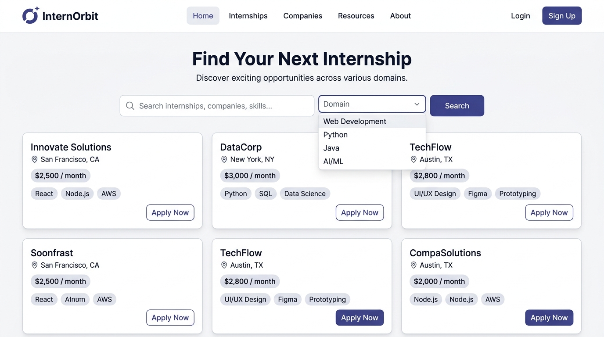

# InternOrbit: Responsive Internship Board

> A lightweight, modern, and accessible internship discovery web application built with semantic **HTML5**, responsive **CSS3**, and **vanilla JavaScript**. No external UI frameworks or third-party runtime dependencies required.



---

## 📌 Project Overview

**InternOrbit** connects students, recent graduates, and career changers with high-quality tech internship listings across in-demand fields including Web Development, Python, Java, Data Science, AI/ML, Cybersecurity, and UI/UX Design.

Built from scratch without React, Bootstrap, or Tailwind CSS, this project demonstrates foundational frontend principles: clean semantic HTML, modular CSS styling using CSS Grid and Flexbox, and responsive DOM manipulation with pure JavaScript.

---

## 🎯 Objectives & Core Features

### 1. Dynamic Rendering
- Reads internship listing data dynamically from a structured [`data/internships.json`](data/internships.json) file.
- Generates responsive card components containing:
  - Role title, company name, and posting timestamp
  - Domain / category badge and work mode badge (Remote, Hybrid, On-site)
  - Key metadata: geographical location, duration, and stipend status
  - Role summary and relevant skills pill tags
  - Accessible "Apply Now" button or "Application link unavailable" badge when direct links are not present.

### 2. Multi-Criteria Live Filtering
- **Real-Time Live Search:** Instant keyword matching across role titles, company names, locations, and technical skill tags.
- **Domain Filter Dropdown:** Seamlessly isolate roles in *Web Development*, *Python*, *Java*, *Data Science*, *AI/ML*, *Cybersecurity*, or *UI/UX Design*.
- **Work Mode Filter:** Toggle between *All Modes*, *Remote*, *Hybrid*, and *On-site* opportunities.
- **Combined Queries:** Live search, domain filtering, and work mode filters work cooperatively.
- **Active Filter Badges:** Displays interactive tags for active filters with one-click removal.

### 3. State Management & Feedback
- **Dynamic Result Counter:** Live announcement of matching listings (e.g., `Showing 14 of 14 internships`) using `aria-live="polite"`.
- **Empty State:** Friendly guidance when queries yield zero matches, complete with an instant "Reset All Filters" action.
- **Error State & Fallback:** Gracefully catches network or JSON parsing failures with a human-readable alert and "Retry Connection" button, backed by built-in fallback data for local `file://` browsing.

### 4. Accessibility First (WCAG 2.1 AA)
- Semantic HTML landmarks: `<header>`, `<nav>`, `<main>`, `<section>`, `<article>`, and `<footer>`.
- Clear, associated `<label>` elements for all form inputs.
- Keyboard navigation support (`Tab`, `Shift+Tab`, `Enter`, `Escape` to clear search).
- Visible focus rings (`:focus-visible`) with 2px contrast offsets.
- High color contrast ratios (exceeding WCAG 4.5:1 text requirements).
- Respects user preference for reduced motion (`prefers-reduced-motion: reduce`).

---

## 🛠️ Technologies Used

| Technology | Role |
| :--- | :--- |
| **HTML5** | Semantic document structure, accessible landmarks, and ARIA labels. |
| **CSS3** | Custom design tokens (CSS variables), CSS Grid, Flexbox, media queries, and accessible focus styles. |
| **Vanilla JavaScript (ES6+)** | Asynchronous data loading (`fetch`), live search, combined filtering, and dynamic DOM rendering. |
| **JSON** | Structured, reusable data store for internship records. |

---

## 📂 Folder Structure

```
responsive-internship-board/
├── index.html              # Main semantic HTML structure & markup
├── style.css               # Clean, modular CSS styling & responsive layouts
├── script.js               # Application logic, filter algorithms & event handlers
├── data/
│   └── internships.json    # JSON database containing sample internship listings
├── README.md               # Detailed project documentation & guides
└── screenshots/
    └── preview.png         # High-resolution UI preview image
```

---

## 🚀 How to Run the Project Locally

Because modern web browsers enforce CORS restrictions on the `fetch()` API when accessing local files via the `file:///` protocol, it is best to run the project using a simple local development server.

### Option 1: Python HTTP Server (Recommended)
Python is pre-installed on most systems.

1. Open your terminal or PowerShell and navigate to the project root:
   ```bash
   cd responsive-internship-board
   ```
2. Start a local HTTP server:
   ```bash
   # Python 3
   python -m http.server 8000
   ```
3. Open your browser and navigate to:
   ```
   http://localhost:8000
   ```

### Option 2: Node.js `npx serve`
If you have Node.js installed:
```bash
npx serve .
```

### Option 3: VS Code Live Server Extension
1. Open the `responsive-internship-board` directory in Visual Studio Code.
2. Right-click on [`index.html`](index.html) and select **"Open with Live Server"**.

*(Note: If opened directly via double-clicking `index.html` on a `file://` URL, the application includes an embedded fallback dataset so the listings remain fully functional even without an HTTP server).*

---

## 🔍 Search & Filtering Architecture

The filtering engine in [`script.js`](script.js) utilizes a centralized state object:

```javascript
const state = {
  allInternships: [],
  filteredInternships: [],
  filters: {
    query: '',
    domain: 'all',
    mode: 'all'
  }
};
```

1. **Input Event Listeners:** As the user interacts with the search input or dropdowns, the `state.filters` values update immediately.
2. **Compound Filter Predicate:**
   - Evaluates whether the listing matches the chosen domain (`item.domain === state.filters.domain || state.filters.domain === 'all'`).
   - Evaluates whether the listing matches the work mode.
   - Performs a case-insensitive sub-string search across `title`, `company`, `location`, `description`, and the `skills` array.
3. **DOM Reconciliation:**
   - If results count is 0, toggles the `.empty-state` container and hides the grid.
   - Otherwise, maps each matched object to an accessible `<article class="internship-card">` template string and updates the DOM.

---

## ♿ Accessibility & Responsive Design Details

- **Keyboard Shortcuts:**
  - `Tab` / `Shift+Tab`: Cycle through interactive elements (inputs, select dropdowns, clear buttons, cards, external links).
  - `Esc`: Instantly clears the search query when the search box is active.
- **Skip Navigation:** A hidden skip link at the top of the page enables keyboard and screen-reader users to jump directly to `#main-content`.
- **Screen Reader Announcements:** The dynamic results counter uses `role="status"` and `aria-live="polite"` so screen-reader users receive prompt audio feedback without interrupting user actions.
- **Responsive Layout Breakpoints:**
  - **Desktop (`> 1024px`):** 3-column or 4-column auto-fill responsive grid, horizontal inline filters.
  - **Tablet (`641px - 1024px`):** 2-column grid layout, grouped 2x2 control panel.
  - **Mobile (`<= 640px`):** Single-column stacked cards, full-width touch-friendly inputs (minimum 44px touch targets).

---

## 🌐 Live Deployment & Publishing Guide

### Step 1: Publish to GitHub
1. Initialize git in the project root:
   ```bash
   git init
   git add .
   git commit -m "feat: initial commit for Responsive Internship Board"
   ```
2. Create a new repository on GitHub (e.g. `responsive-internship-board`).
3. Link your remote and push:
   ```bash
   git remote add origin https://github.com/<YOUR-USERNAME>/responsive-internship-board.git
   git branch -M main
   git push -u origin main
   ```

### Step 2: Deploy to GitHub Pages (Free)
1. Go to your repository on GitHub.
2. Navigate to **Settings** > **Pages** (in the left sidebar).
3. Under **Build and deployment** > **Source**, select `Deploy from a branch`.
4. Under **Branch**, select `main` and folder `/ (root)`, then click **Save**.
5. Within 1–2 minutes, your website will be live at:
   `https://<YOUR-USERNAME>.github.io/responsive-internship-board/`

### Step 3: Deploy to Netlify (Alternative)
1. Log in to [Netlify](https://www.netlify.com).
2. Click **Add new site** > **Import an existing project** > **GitHub**.
3. Select your `responsive-internship-board` repository.
4. Leave build settings default (no build command needed for vanilla HTML/CSS/JS) and click **Deploy Site**.

---

## 🔗 Links Placeholder

- **GitHub Repository:** `https://github.com/<YOUR-USERNAME>/responsive-internship-board` *(Replace with your repository URL)*
- **Live Demo Site:** `https://<YOUR-USERNAME>.github.io/responsive-internship-board/` *(Replace with your live deployment URL)*

---

## ✅ Submission Checklist

- [x] Dynamic rendering of internship cards from JSON data.
- [x] Live search functional across title, company, description, and skills.
- [x] Domain filter functional across all 7+ primary tech domains.
- [x] Combined search and domain filtering work harmoniously.
- [x] Reset / clear filters button restores full dataset.
- [x] Live results counter updates accurately with polite ARIA announcements.
- [x] Friendly Empty State with reset action when no results match.
- [x] Graceful Error State with connection retry handling.
- [x] Missing application links display "Application link unavailable".
- [x] Full keyboard accessibility with visible focus rings and skip link.
- [x] Semantic HTML5 tags and form label associations.
- [x] Tested across mobile, tablet, and desktop breakpoints.
- [x] Zero external frontend frameworks (Pure HTML, CSS, JavaScript).

---

## 📄 License
This project is open-source and available under the [MIT License](LICENSE).
